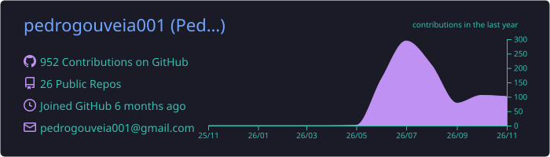
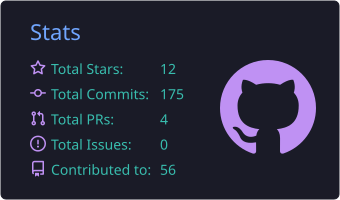
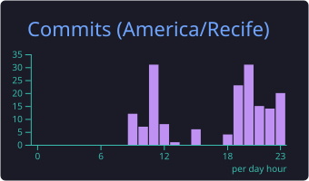
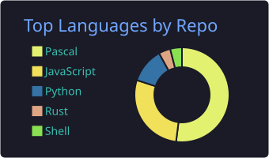
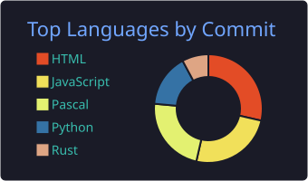

# Pedro Henrique Gouveia de Souza

**Backend & AI Engineering — Python · FastAPI · PostgreSQL · Decision Science & Applied AI**

Recife, Pernambuco, Brasil
[LinkedIn](https://www.linkedin.com/in/pedro-gouveia-7b81471b8) · [E-mail](mailto:pedrogouveia001@gmail.com) · [sad-mcdm](https://github.com/sad-mcdm)

---

### O que eu faço

Construo backend em Python: desenho de API, modelagem de dados relacional, autorização e suíte de teste automatizado. O que me interessa é a parte que só aparece depois do deploy — isolamento de dado entre clientes garantido pelo banco, migração versionada, regressão pega antes do merge.

**Stack de trabalho**

| | |
| :--- | :--- |
| **Backend** | Python 3.12 · FastAPI · Flask · SQLAlchemy 2 (async) · Pydantic · Alembic |
| **Banco** | PostgreSQL (Row Level Security, JSONB, índice trigram) · MySQL · SQLite · modelagem conceitual/lógica/física |
| **Teste & qualidade** | Pytest · pytest-asyncio · teste de integração contra banco real · Ruff · SBOM (CycloneDX) |
| **Entrega** | Git/GitHub (Pull Request, CODEOWNERS, Git LFS) · OpenAPI · JWT + argon2 + TOTP · Jinja2 |
| **Nuvem** | AWS (ECS Fargate, S3, CloudFront, Secrets Manager, CloudWatch) · Docker |
| **Front & mobile** | React · TypeScript · Vite · Vitest · Playwright · Capacitor (Android/iOS) · Expo |
| **Regulatório** | IEC 62304 (software de dispositivo médico, classe B) · LGPD · rastreabilidade requisito → código → teste |
| **Computação numérica** | NumPy · SciPy · Pandas · simulação de Monte Carlo |
| **Legado** | Delphi / Object Pascal · VBA |

---

### Projetos em Destaque

**[spear-elicitation-simulator](https://github.com/pedrogouveia001/spear-elicitation-simulator)** — Python · NumPy · pytest · GitHub Actions CI
Simulador de linha de comando que compara quatro heurísticas de seleção de pergunta para elicitação de preferências em decisão multicritério: mede quantas perguntas cada heurística precisa até convergir dentro de uma tolerância. Projeto final do CS50P (Harvard).

**[Cerebrum-IA](https://github.com/pedrogouveia001/Cerebrum-IA)** — Rust · Tauri · SQLite · Docker
Plataforma desktop de memorização e inteligência com backend nativo em Rust, SQLite embarcado e empacotamento multi-stage Docker.

**[toefl-prep-app](https://github.com/pedrogouveia001/toefl-prep-app)** — JavaScript (ES6+) · Web Speech API · Levenshtein Distance
Aplicação web interativa e gamificada de preparação para o TOEFL iBT, com reconhecimento de fala no navegador para speaking drills e sintetizador de voz.

**[criterial](https://github.com/pedrogouveia001/criterial)** — Tailwind CSS · Decision Science · Web UI
Showcase e portal institucional da Criterial, demonstrando sistemas de inteligência de decisão multicritério e engenharia de software de alta performance.

**Projetos profissionais** — repositórios privados, código proprietário

| Projeto | Stack | O que é |
| :--- | :--- | :--- |
| Plataforma clínica | FastAPI · SQLAlchemy 2 (async) · PostgreSQL 16 (RLS) · Alembic · Pytest | API multi-clínica de software de dispositivo médico (IEC 62304 classe B): motor de fórmulas, prontuário, indicadores e assinatura digital ICP-Brasil |
| App de centro cirúrgico | React · TypeScript · Capacitor · Swift · Vosk | App de tablet para registro em tempo real dentro do centro cirúrgico, com voz offline e mapa 3D |
| App de bancada | Expo · React Native | Contador de bancada que alimenta os indicadores do processo |
| Sistema de gestão da qualidade | FastAPI · Jinja2 · PostgreSQL · Docker | Registros exigidos pela ISO 13485: aprovação de documento, não conformidade e CAPA, auditoria interna e liberação de versão |
| Plataforma de ensino | FastAPI · React (PWA) · PostgreSQL | Cursos, avaliação de habilidade por vídeo, TOTP, notificações push e OCR de PDF |
| Sites e portal editorial | Next.js · React · Vite · Python | Site institucional, portal de notícias e vitrine de produtos |

---

### Software médico (2026– )

Desenvolvimento backend e liderança técnica de um sistema de medição e controle de processo cirúrgico, desenvolvido como **software de dispositivo médico sob IEC 62304, classe B**. O código é proprietário e fica em repositórios privados; o resumo do que foi construído:

- **Plataforma clínica (FastAPI + PostgreSQL)** — API assíncrona (SQLAlchemy 2 + asyncpg) com isolamento multi-clínica por Row Level Security no PostgreSQL 16, matriz de capacidades por papel, trilha de auditoria e migrações por Alembic. Motor de fórmulas próprio (parser + evaluator) para o planejamento cirúrgico, prontuário eletrônico, indicadores e assinatura digital ICP-Brasil em nuvem. Suíte de teste contra Postgres real, ~1.300 commits.
- **App de centro cirúrgico (React + Capacitor)** — app de tablet usado dentro do centro cirúrgico para registro de contagens em tempo real, com reconhecimento de voz offline (Vosk) e mapa 3D. Android em produção; porte do plugin de voz para iOS em Swift.
- **App de bancada (Expo / React Native)** — contador de bancada que alimenta as taxas do processo cirúrgico.
- **Plataforma de ensino (FastAPI + React PWA)** — cursos, avaliação de habilidade por vídeo, autenticação com TOTP, push e OCR de PDF.
- **Infraestrutura e qualidade** — deploy em AWS (ECS Fargate, S3, CloudFront), SBOM/lista de SOUP versionada, sistema de gestão da qualidade com documentos controlados e rastreabilidade requisito → código → teste.

---

### Sistemas de apoio à decisão — CDSID/UFPE (2022–2026)

Quatro anos construindo software de decisão multicritério no Centro de Desenvolvimento de Sistemas de Informação e Decisão da UFPE. O código está arquivado em repositórios privados; o resumo do que foi construído:

- **FITradeoff Web (Flask + MySQL)** — reescrita web do FITradeoff: autenticação, cadastro e retomada de problema salvo, importação de matriz de consequências em `.csv`/`.xlsx`, motor de cálculo aditivo com pesos ROC, preferência holística e por decomposição, análise de sensibilidade por Monte Carlo com teste de Kendall, exportação em PDF e CSV, i18n PT/EN. Inclui a migração do banco legado (`fitradeoff_data`) para o esquema novo.
- **FITradeoff-CB-HE** — seleção de portfólio de projetos por razão custo-benefício. **Registro de software no INPI nº 512025006292-3** (coautor: módulos de cálculo e fluxo de uso do método).
- **SPEAR / Surrogate / PROMETHEE / NSGA-II** — motores de cálculo e simulação em Delphi/Object Pascal e Python, usados em sessões reais de elicitação de preferências com decisores.
- **Portal bibliométrico do FITradeoff** — sincronização entre o raspador da página oficial e a API do OpenAlex, com desduplicação por DOI/título e grafo de coautoria em D3.js.

**Repositórios públicos desse período:**

| Repositório | O que é |
| :--- | :--- |
| [cdsid-spear](https://github.com/pedrogouveia001/cdsid-spear) | SPEAR — elicitação por decomposição: Delphi/IntraWeb + camada web em Flask |
| [cdsid-dashboard-fitradeoff](https://github.com/pedrogouveia001/cdsid-dashboard-fitradeoff) | Portal bibliométrico: raspador + API OpenAlex, desduplicação por DOI e grafo de coautoria em D3.js |
| [cdsid-promethee-roc](https://github.com/pedrogouveia001/cdsid-promethee-roc) | PROMETHEE com pesos ROC — SAD multicritério |
| [cdsid-promethee-c-optimal](https://github.com/pedrogouveia001/cdsid-promethee-c-optimal) | PROMETHEE C Ótimo — portfólio por razão custo-benefício com otimização |
| [cdsid-promethee-rocnratio](https://github.com/pedrogouveia001/cdsid-promethee-rocnratio) | PROMETHEE ROC/N-Ratio — elicitação de pesos e análise de sensibilidade |
| [cdsid-stratplan](https://github.com/pedrogouveia001/cdsid-stratplan) | Planejamento estratégico com otimização multiobjetivo (NSGA-II) |
| [cdsid-nsgaii-intraweb](https://github.com/pedrogouveia001/cdsid-nsgaii-intraweb) | NSGA-II em aplicação web — algoritmo genético multiobjetivo |
| [cdsid-sadpf](https://github.com/pedrogouveia001/cdsid-sadpf) | Seleção de portfólio com diagrama de Hasse para ordenação parcial |
| [cdsid-sadsds](https://github.com/pedrogouveia001/cdsid-sadsds) | SAD para alocação de recursos em segurança pública |
| [cdsid-holistica-classificacao](https://github.com/pedrogouveia001/cdsid-holistica-classificacao) | Avaliação holística e problemática de classificação |
| [cdsid-sw-cadastro](https://github.com/pedrogouveia001/cdsid-sw-cadastro) | Cadastro único — autenticação compartilhada entre os SADs do laboratório |
| [cdsid-surrogate-simulacao](https://github.com/pedrogouveia001/cdsid-surrogate-simulacao) · [-python](https://github.com/pedrogouveia001/cdsid-surrogate-simulacao-python) | Simulação de heurísticas com pesos surrogate — Delphi e Flask |
| [cdsid-surrogate-input](https://github.com/pedrogouveia001/cdsid-surrogate-input) · [-python](https://github.com/pedrogouveia001/cdsid-surrogate-input-python) | Entrada de dados para métodos surrogate — Delphi e Flask |
| [cdsid-pl-input](https://github.com/pedrogouveia001/cdsid-pl-input) · [cdsid-ppl-simulacao](https://github.com/pedrogouveia001/cdsid-ppl-simulacao) | Entrada e simulação de programação linear, com solver lp_solve |
| [cdsid-colab-notebooks](https://github.com/pedrogouveia001/cdsid-colab-notebooks) | Notebooks de otimização e métodos numéricos — Python/Jupyter |

> Os repositórios contêm apenas código-fonte de minha autoria. Dumps de banco, planilhas de
> aplicação real e trabalho de colegas foram mantidos fora. Componentes de terceiros
> redistribuídos (lp_solve, LGPL) estão creditados em `THIRD-PARTY.md`.

**Produção derivada desse software:** capítulo na Springer Nature (LNBIP, 2025) · INFORMS Annual Meeting 2024 (Seattle) · 27th International Conference on MCDM 2024 (Tunísia) · SBPO.

---

### [sad-mcdm](https://github.com/sad-mcdm) — open source

Suíte de resolvedores de decisão multicritério, mantida por mim.

- **[sad-mcdm-lib](https://github.com/sad-mcdm/sad-mcdm-lib)** (Python) — pacote unificado: `solve_ahp`, `solve_bwm`, `solve_bwt`, `solve_electre`, `solve_macbeth`, `solve_promethee`, `solve_smarts_smarter`, `solve_topsis`, `solve_vikor`, `run_monte_carlo` e geração de relatório em PDF.
- **Bindings:** [R](https://github.com/sad-mcdm/sad-mcdm-r) · [JavaScript](https://github.com/sad-mcdm/sad-mcdm-js) (com Simplex de duas fases no navegador) · [C++](https://github.com/sad-mcdm/sad-mcdm-cpp) · [Julia](https://github.com/sad-mcdm/sad-mcdm-julia) · [Java](https://github.com/sad-mcdm/sad-mcdm-java)
- **[sad-central-mcdm](https://github.com/sad-mcdm/sad-central-mcdm)** — hub que processa matriz de consequências e exporta relatório executivo em PDF.
- **Aplicações:** [PrometheeInvestor](https://github.com/sad-mcdm/sad-promethee-b3) e [SAD Smarter B3](https://github.com/sad-mcdm/sad-smarter-b3) — análise fundamentalista de ações da B3.

---

### Formação

- **Engenharia de Produção** — Universidade Federal de Pernambuco (set/2021 – dez/2025)
- **Mestrado em Engenharia de Produção** — UFPE (mar/2026 – ago/2026, interrompido)
- **Técnico em Mecânica** — IFPE Campus Recife (2017 – 2021)

**Certificações:** CS50x e CS50P (Harvard) · CS50's Introduction to Databases with SQL · Artificial Intelligence Essentials V2 · Introduction to Cloud Computing · Hands-on Introduction to Linux Commands and Shell Scripting · Python (Basic) Certificate

---

### Estatísticas do GitHub

  

  
  

  
  

